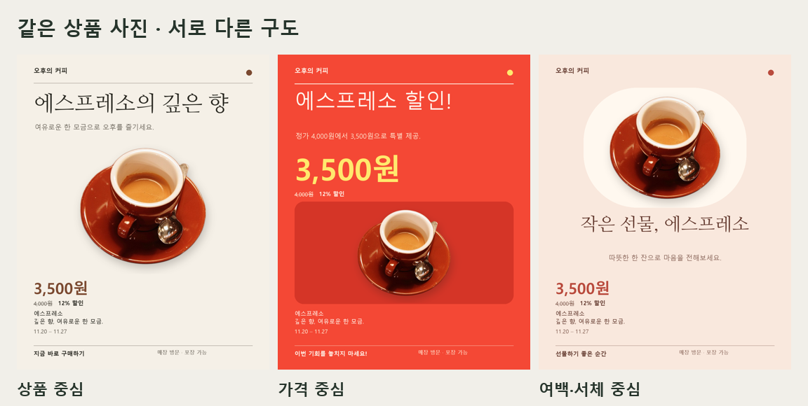
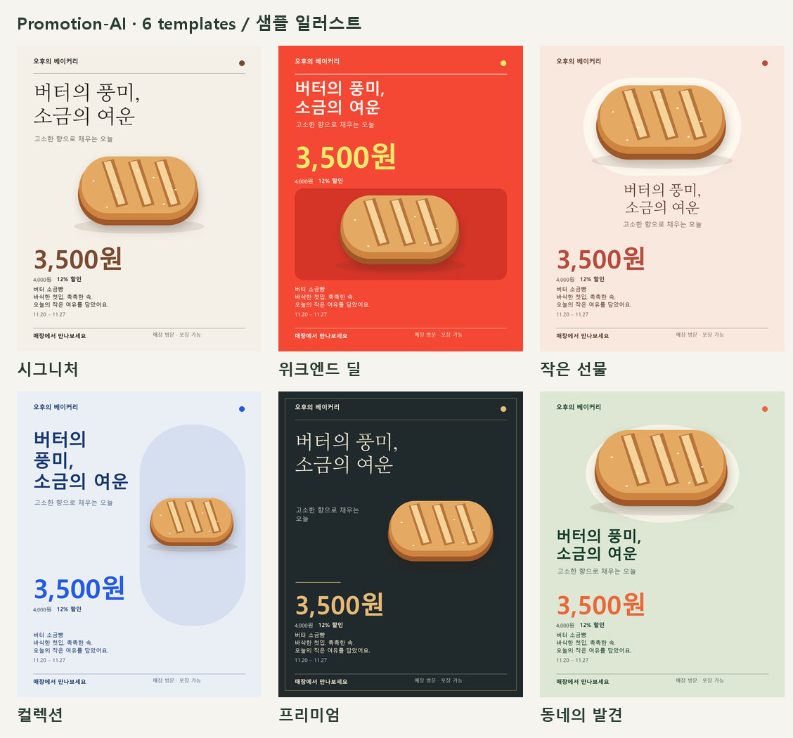

# Promotion-AI

I-AM-ERICA 서비스의 소상공인 홍보 비서입니다. **별도 학습·GPU 없이** CLOVA Studio와 템플릿으로 포스터를 만듭니다. 상품 배경 제거는 로컬 CPU에서 사전 학습된 U2Net을 실행합니다.

상품 사진·가게 정보 입력 → 배경 제거·그림자 → 상품 중심 / 가격 중심 / 여백·서체 중심 시안 3개 → 자연어 수정 → **1080×1350 PNG 저장**.



같은 CC0 상품 사진을 배경 제거한 뒤 실제 CLOVA 문구로 렌더링했습니다. 가상 매장과 예시 가격을 사용했습니다. [사진·폰트 출처](docs/THIRD_PARTY.md).



위 이미지는 가상 매장과 자체 제작한 상품 **일러스트**로 렌더링한 예시입니다. 실제 상품 광고에는 사장님의 상품 사진을 사용하세요.

## 바로 실행하기

Python **3.11–3.13**이 필요합니다. Python 3.12 / Windows에서 검증했습니다.

PowerShell:

```powershell
Set-Location -LiteralPath 'C:\Users\hailab\Desktop\Promotion-AI'
python run.py --demo --studio
```

다른 컴퓨터에서는 clone한 폴더에서 같은 명령을 실행하면 됩니다. 첫 실행에 CPU용 Python 패키지를 설치하고, 이후에는 같은 환경을 재사용합니다. 전용 가상환경과 결과 데이터는 Windows의 `%LOCALAPPDATA%\Promotion-AI`에 보관하여 소스와 분리합니다.

첫 실행은 U2Net 가중치(약 176MB)를 다운로드하므로 시간이 걸립니다. 모델은 사용자 홈의 rembg 캐시에 저장하고 재사용합니다. 배경 제거 없이 먼저 실행하려면 `python run.py --demo --studio --no-cutout`을 사용하세요.

사진 배경은 **자동으로 배경 정리 / 배경 제거하기 / 원본 배경 유지** 중 선택합니다. 자동 모드에서 모델 준비·분리에 실패하면 원본을 사용하고 화면에 안내합니다. 제거하기 모드는 실패 시 재선택을 안내합니다. 투명 PNG는 그대로 사용합니다. 원본 RGB를 다시 그리지 않고 알파 마스크와 그림자만 합성하며, 원본 사진과 제거 결과를 함께 보관하여 수정 시 재사용합니다. 반사·투명 제품이나 복잡한 배경은 가장자리를 확인하고 필요하면 원본 배경을 유지하세요.

브라우저에서 **http://127.0.0.1:8081** 을 열고 다음 순서로 확인하세요.

1. **예시 채우기** 또는 직접 상품 정보와 사진 입력.
2. **시안 3개 만들기** → 원하는 카드 선택.
3. **초록색으로**, **가격 강조** 또는 6개 템플릿 중 하나 선택.
4. **PNG 저장**. 종료는 실행 터미널에서 `Ctrl+C`.

**체험 모드는 CLOVA API를 호출하지 않습니다.** 고정 문구와 세 가지 기본 템플릿을 사용하며, 수정은 색상·서체·가격 강조·사진 채움·템플릿 선택을 지원합니다. 로컬 U2Net 배경 제거는 체험 모드에서도 동작합니다. 자유로운 문구 수정과 참고 이미지 분석은 CLOVA 연결 모드에서 동작합니다.

가상환경을 직접 관리하려면:

```powershell
python -m venv .venv
.\.venv\Scripts\python.exe -m pip install -r requirements-serving.txt
.\.venv\Scripts\python.exe -m promotion_assistant --demo --studio
```

## CLOVA Studio 연결하기

`.env.example`을 `.env`로 복사하고 값을 입력합니다. **API 키를 GitHub나 채팅에 올리지 마세요.**

```dotenv
CLOVA_STUDIO_API_KEY=<CLOVA Studio API 키>
AI_INTERNAL_KEY=<기존 Spring 백엔드와 동일한 내부 키>
POSTER_PUBLIC_BASE_URL=http://127.0.0.1:8081
```

```powershell
python run.py --studio
```

- **HCX-007**: 템플릿·팔레트 선택, 문구 생성, 자연어 수정. JSON Structured Outputs를 사용합니다.
- **HCX-005**: 스타일 참고 이미지를 올렸을 때만 색감·구도 분석. 상품 사진은 LLM에 전달하지 않고 렌더러가 원본을 합성합니다.
- 상품 사진, 스타일 참고 이미지, 로고를 구분합니다. 이미지의 글씨·가격을 사실 정보로 가져오지 않습니다.
- 일반 생성은 HCX-007 1회로 시안 3개를 만듭니다. 자유로운 문구 수정은 1회, 스타일 참고 분석은 HCX-005 1회가 추가됩니다. 색상·서체·템플릿 버튼과 동일한 명확한 요청은 API 없이 적용합니다. 별도 학습은 없습니다.
- 모델 접근 권한과 사용량 한도는 CLOVA 계정에서 확인하세요.

공식 규격: [HCX-007 Structured Outputs](https://api.ncloud-docs.com/docs/clovastudio-chatcompletionsv3-so), [HCX-005 텍스트·이미지](https://api.ncloud-docs.com/docs/clovastudio-chatcompletionsv3).

**검증 범위 (2026-11-17):** 실제 HCX-007 키로 판매가 3,500원·정가 4,000원 시안 3개 생성과 자연어 제목·설명 수정을 확인했습니다. U2Net CPU 배경 제거, 브라우저 사진 업로드·시안 선택·색상/서체 수정·1080×1350 PNG 저장을 확인했습니다. HTTP/gRPC 등 자동 테스트 72개를 통과했습니다. HCX-005 스타일 분석과 오류 응답은 모의 HTTP 테스트 범위입니다. Docker 실행은 아직 검증하지 않았습니다.

## 서비스 구조와 팀 연동

```text
기존 React 화면 → Spring (JWT · 매장 소유권) → gRPC :50052
                                                 ↓
                             HCX 디자인 JSON → 입력 검증 → Pillow PNG
                                                 ↓
                                    SQLite · 버전별 이미지 파일

로컬 편집 화면 → HTTP :8081 → 같은 생성 엔진
```

- 기존 `PromotionAssistant.CreatePoster` 요청·응답 필드와 RPC 경로를 유지합니다.
- 추가 RPC: `CreateDrafts`, `RevisePoster`, `GetPoster`.
- `x-internal-key` 인증, gRPC health, deadline·취소·오류 매핑을 제공합니다.
- 기존 백엔드의 홍보 요청은 사진을 전달하거나 시안 배열을 반환하지 않습니다. **3개 시안·이미지 업로드·수정 기능의 통합 서비스 노출에는 팀의 백엔드/프론트엔드 연동이 필요합니다.**
- 다른 I-AM-ERICA 레포는 변경하지 않았습니다.

필드 번호, 환경 변수, REST 예시, mock 포트 충돌, 프론트 연결 작업은 **[팀 연동 문서](docs/INTEGRATION.md)** 에 정리했습니다.

## 제공하는 디자인과 보존 규칙

| 템플릿 | 용도 |
|---|---|
| 시그니처 | 명조 제목 아래 큰 상품, 여백 중심 |
| 위크엔드 딜 | 큰 가격을 위에, 상품을 아래에 배치 |
| 작은 선물 | 상단 아치 속 상품, 하단 편지형 문구 |
| 컬렉션 | 왼쪽 가격·문구, 오른쪽 세로 상품 영역 |
| 프리미엄 | 명조 제목·짙은 배경, 오른쪽 아래 상품 |
| 동네의 발견 | 큰 상품을 먼저, 제목을 아래에 배치 |

AI가 비슷한 구도를 골라도 서버에서 세 구도군을 하나씩 구성합니다. 제목은 고딕/굵은 고딕/나눔명조를 지원하고 한글 단어·명시적 줄바꿈을 우선합니다. 가격과 단위를 한 덩어리로 유지하며 짧은 제목의 줄 길이를 균형 있게 맞춥니다.

가격 검증은 `3,500원`, `3500 원`, `3천5백원` 등 같은 금액의 표기를 구별하지 않습니다. 정가·판매가에서 확인되는 할인액과 할인율은 허용하고, 입력과 무관한 숫자나 잘못된 할인율은 계속 거절합니다.

템플릿과 팔레트는 코드로 관리합니다. LLM이 임의 HTML·좌표·이미지 URL을 실행하지 않습니다. 가격·기간·상품명·원본 사진은 서버에 저장된 입력으로 렌더링하며, 수정할 때 이전 버전을 덮어쓰지 않습니다. 할인율은 정가/판매가로 계산해 내림 표시합니다.

사진 전체 보존이 기본이며, 원본 배경 사진은 요청 시 채움(crop)으로 바꿀 수 있습니다. 배경 제거된 상품은 전체 윤곽을 유지하고 부드러운 그림자를 더합니다. 로고의 투명도를 보존합니다. 긴 한글은 측정해서 줄바꿈/축소하고, 최소 글자 크기로도 맞지 않으면 잘라내지 않고 오류를 안내합니다. 과도하게 긴 문구는 줄여 주세요. 상품 이미지 생성·기존 광고의 픽셀 단위 복제는 포함하지 않습니다.

## 배포와 설정

로컬 스튜디오는 `--studio`로만 활성화되며 loopback에서만 열립니다. 운영은 Spring 뒤의 내부 서비스로 실행하세요.

```bash
python -m promotion_assistant --host 0.0.0.0 --grpc-address 0.0.0.0:50052
```

Docker:

```bash
docker build -t promotion-ai .
docker run --rm --env-file .env -p 127.0.0.1:8081:8081 -p 127.0.0.1:50052:50052 -v promotion-data:/data promotion-ai
```

| 환경 변수 | 의미 |
|---|---|
| CLOVA_STUDIO_API_KEY | live 모드 필수 |
| AI_INTERNAL_KEY | Spring과 공유하는 내부 키; 브라우저에 전달 금지 |
| POSTER_PUBLIC_BASE_URL | 사용자의 브라우저에서 접근 가능한 이미지 기본 주소 |
| POSTER_DATA_DIR | SQLite·PNG 저장 경로. Drive 동기화 대상 밖의 영속 디스크 권장 |
| POSTER_TIMEOUT_SECONDS | 기본 70초, 허용 5~85초 |
| POSTER_FONT_PATH | 한글 일반 서체 경로 |
| POSTER_BOLD_FONT_PATH | 한글 굵은 서체 경로 |

본문 고딕은 Windows의 맑은 고딕, macOS의 Apple SD Gothic Neo, Linux의 Noto Sans CJK를 탐색합니다. Linux에서는 `fonts-noto-cjk`를 설치하거나 폰트 경로를 지정하세요. 제목용 NAVER 나눔명조 Regular/ExtraBold와 OFL 라이선스는 `promotion_assistant/fonts`에 포함합니다.

Dockerfile을 제공하지만 Docker 실행은 이 개발 환경에서 검증하지 않았습니다. 생성 이미지는 무작위 URL을 아는 사람이 내려받을 수 있는 공유 파일입니다. 운영 보관 기간/삭제 정책·Object Storage·다중 서버 배포는 팀 인프라에 맞춰 추가해야 합니다.

## 테스트

```powershell
python -m venv .venv
.\.venv\Scripts\python.exe -m pip install -r requirements-dev.txt
.\.venv\Scripts\python.exe -m pytest -q
.\.venv\Scripts\python.exe -m examples.render_gallery
```

- 템플릿 6개 × 사진 유무, 한글 길이/레이아웃, 이미지 크기·형식 검증.
- 판매가/정가, 없는 숫자·단위의 생성 거절.
- CLOVA JSON/오류/잘린 응답, HCX-005 스타일 분석 요청, 사실 수정 안내.
- 세 시안 생성, 저장 재개, 수정 버전 충돌, 소유 매장 검사, 취소 후 미저장.
- HTTP 인증·CSRF·크기 제한·PNG 다운로드.
- **원래 6개 필드만 아는 gRPC 클라이언트**의 호환 호출, 확장 RPC, 표준 health.
- 배경 제거의 원본 RGB 보존·실패 안내, 기존 DB 마이그레이션, 3개 시안과 수정의 컷아웃 재사용.
- 가격 단위 줄바꿈, 명조 제목, 세 구도군 선택, 명확한 수정과 복잡한 지시의 분리.

같은 사진으로 배경 제거와 시안을 직접 확인하려면 `python -m examples.render_product_demo`를 실행하세요. 개발 가상환경에서 실행하며 결과는 `outputs/product-demo`에 저장합니다. `--env-file .env`를 추가하면 실제 CLOVA 생성 1회와 문구 수정 1회를 호출합니다.

proto 변경 후 코드 생성:

```bash
python -m grpc_tools.protoc -I serving/proto --python_out=. --grpc_python_out=. serving/proto/america/ai/v1/common.proto serving/proto/america/ai/v1/promotion.proto
```

`america/ai/v1/*_pb2*.py`는 생성 파일입니다. proto와 함께 커밋해야 합니다.

## 코드 위치

- `promotion_assistant/models.py`: 입력·디자인 스키마와 사실 검증
- `templates.py`, `renderer.py`: 팔레트·레이아웃·PNG 합성
- `clova.py`: HCX-007/005 클라이언트와 명시적인 체험 모드
- `engine.py`, `storage.py`: 생성·수정 흐름과 영속 저장
- `grpc_service.py`, `api.py`: 기존 서비스 계약과 HTTP
- `static/`: 로컬 검증용 편집 화면
- `serving/proto/`: 백엔드가 가져갈 gRPC 계약
- `run.py`: 머신별 가상환경을 자동 준비하는 실행기
