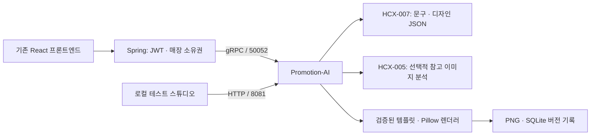

# I-AM-ERICA 연동 규격

2026-11-17에 GitHub에서 실제 코드를 확인했습니다. 이 저장소만 변경했으며 백엔드·프론트엔드의 배포를 변경하지 않았습니다.

## 확인한 기존 구조

- [am-erica-frontend / MarketingPage](https://github.com/I-AM-ERICA/am-erica-frontend/blob/main/src/pages/MarketingPage.tsx): 상품/참고 이미지, 상품명, 글귀, 톤을 입력하고 이미지 1개와 문구를 표시합니다. `onGenerate` 어댑터는 연결 지점으로 남아 있습니다.
- [marketing.ts](https://github.com/I-AM-ERICA/am-erica-frontend/blob/main/src/services/marketing.ts): `referenceImage = {name, base64, mediaType, previewUrl}`; 응답은 `{headline, body, hashtags, imageUrl}`입니다.
- [Spring AiController](https://github.com/I-AM-ERICA/am-erica-backend/blob/main/src/main/java/com/america/backend/ai/AiController.java): `POST /api/stores/{storeId}/ai/promotion/poster`.
- [AiOrchestrator](https://github.com/I-AM-ERICA/am-erica-backend/blob/main/src/main/java/com/america/backend/ai/AiOrchestrator.java): JWT 사용자와 매장 소유권 확인 → StoreContext 구성 → gRPC 호출 → 호출 이력 저장.
- [기존 promotion.proto](https://github.com/I-AM-ERICA/am-erica-backend/blob/main/src/main/proto/america/ai/v1/promotion.proto): `america.ai.v1.PromotionAssistant/CreatePoster`.
- 기본 홍보 gRPC 포트 50052, 메타데이터 `x-internal-key`, 기본 백엔드 deadline 90초입니다.
- Search-R1의 실제 Python gRPC 서버와 같은 내부 키 검사·표준 health protocol을 사용합니다.



## 기존 백엔드로 바로 호출하는 범위

기존 요청 필드 1~6, 기존 응답 필드 1~4와 RPC 이름을 변경하지 않았습니다. 기존 proto로 생성한 Java 클라이언트를 그대로 사용할 수 있습니다.

```json
{
  "product": "버터 소금빵",
  "message": "이번 주 매장에서 만나보세요",
  "tone": "따뜻하고 친근하게",
  "channel": "instagram",
  "generateImage": true
}
```

응답은 `headline/body/hashtags/imageUrl`입니다. `generateImage=false`는 문구만 반환합니다. `true`는 내부에서 생성한 3개 중 첫 번째 PNG를 반환합니다. 기존 요청에는 이미지 필드가 없으므로 이 호출은 문구 중심 포스터로 동작합니다.

Spring 환경 변수:
```dotenv
AI_PROMOTION_HOST=127.0.0.1
AI_PROMOTION_PORT=50052
AI_INTERNAL_KEY=<Promotion-AI와 동일한 키>
AI_GRPC_DEADLINE=90s
AI_GRPC_TLS=false
AI_MOCK_ENABLED=false
```

현재 백엔드의 local 프로필은 전체 비서 mock을 실행합니다. `AI_MOCK_ENABLED=false`로 꺼야 실제 홍보 서버와 50052 포트가 충돌하지 않습니다. 이 설정은 **다른 비서 mock도 함께 끕니다**. 정책에만 개별 mock 스위치가 있고 홍보에는 없습니다. 다른 비서 mock을 유지하려면 백엔드 담당자가 promotion 개별 스위치를 추가해야 합니다.

컨테이너를 쓰면 `127.0.0.1` 대신 같은 내부 네트워크의 서비스명을 사용합니다. 이 Python gRPC 서버 자체는 TLS를 제공하지 않습니다. 내부망에 두거나 TLS 종료 프록시를 사용하고 백엔드 TLS 설정을 그 경계에 맞추세요.

## 사진 · 시안 3개 · 수정 기능 연결

이 저장소의 `serving/proto/america/ai/v1/promotion.proto`를 백엔드 담당자가 반영하고 Java 스텁을 재생성하면 다음 RPC를 사용할 수 있습니다.

| RPC | 입력 | 결과 |
|---|---|---|
| CreatePoster | PosterRequest | 기존 PosterResult 1개 |
| CreateDrafts | PosterRequest | 서로 다른 템플릿의 PosterDraft 3개 |
| RevisePoster | store_id, draft_id, instruction, expected_version | 새 버전의 PosterDraft 1개 |
| GetPoster | store_id, draft_id | 최신 버전 |

추가 요청 필드:

| 필드 번호 | 필드 | 의미 |
|---|---|---|
| 7 | product_image | 실제 상품 사진; PosterImage |
| 8 | logo | 가게 로고; PosterImage |
| 9 | style_reference | 색감·배치 참고 이미지; PosterImage |
| 10 | optional price | 원 단위 판매가; 0원과 미입력 구별 |
| 11 | optional original_price | 판매가보다 큰 정가 |
| 12 | period | 그대로 표시할 기간 |
| 13 | contact | 방문·문의 안내 |
| 14 | background_mode | auto(기본), remove, keep |

`PosterDraft.image_processing_json`(필드 8)은 `{"background":"removed|transparent|kept|none","warning":"..."}`입니다. 프론트에서 warning을 표시하세요. HTTP 응답은 같은 내용을 `image_processing` 객체로 제공합니다. 기존 proto 클라이언트는 추가 필드를 무시하므로 기존 RPC도 계속 동작합니다.

3개 시안은 상품 중심(hero), 가격 중심(offer), 여백·서체 중심(brand) 구도를 하나씩 반환합니다. 디자인 JSON의 `typography`는 auto/sans/serif/bold이며 자연어 수정으로 변경할 수 있습니다. 배경 모드 변경은 새 생성 요청에서 적용합니다.

`PosterImage.data`는 **raw bytes**입니다. 프론트엔드 base64를 백엔드에서 한 번 디코딩해 ByteString으로 전달합니다. `media_type`은 image/png, image/jpeg, image/webp 중 하나입니다. 파일당 최대 5MiB, 최대 2천만 화소입니다.

프론트의 기존 `referenceImage`는 의미가 혼합되어 있습니다. 실제 상품 사진은 `product_image`, 광고 스타일 참고는 `style_reference`로 UI에서 구분하세요. 상품 사진은 PNG 합성에만 사용하고, 스타일 참고 이미지만 HCX-005에 전송합니다.

백엔드 담당자 작업:
1. DTO에 사진·가격·기간 필드를 추가하고 이미지 크기를 검증합니다.
2. 기존과 같이 `requireOwned(userId, storeId)`를 실행하고, **클라이언트가 보낸 store_id를 그대로 신뢰하지 않고** 조회한 StoreContext를 전달합니다.
3. CreateDrafts, RevisePoster, GetPoster를 중계할 인증된 REST 경로를 추가합니다.
4. `id/version/design_json/result/mode`를 응답에 포함합니다. 수정 요청은 표시 중인 `expected_version`을 보내고 ABORTED는 HTTP 409로 처리합니다.
5. Spring의 inbound gRPC message limit은 이미지가 들어가는 **요청 송신에는** 적용되지 않지만 프록시/REST body limit을 base64 약 21MB까지 고려해야 합니다. Python gRPC 수신 제한은 17MiB, HTTP는 22MiB입니다.

프론트 담당자 작업:
1. 기존 MarketingGenerator에 Spring 경유 어댑터를 연결합니다.
2. 시안 3개 배열의 선택 UI, 자연어 수정 입력, version 상태를 추가합니다.
3. 기존 `downloadMarketingImage`는 공개 imageUrl을 사용할 수 있습니다. 생성 이미지 응답은 PNG이며 CORS `*`를 이미지 경로에만 제공합니다.
4. 이 저장소의 브라우저 스튜디오는 기능 검증용입니다. 서비스 로그인/매장 권한을 대체하지 않습니다. **AI_INTERNAL_KEY와 CLOVA 키를 브라우저에 넣지 마세요.**

## HTTP 내부 API

gRPC 외에 같은 엔진의 HTTP API도 제공합니다. Spring 서버에서 호출할 때만 `X-Internal-Key`를 사용합니다.

- `GET /health`: 프로세스/설정 준비 상태. 실제 CLOVA 도달성 검사는 하지 않습니다.
- `GET /v1/templates`: 템플릿 목록.
- `GET /v1/fonts`: 글꼴 목록 `{fonts:[{id,name,description}]}`. 동일한 내부 인증이 필요합니다.
- `POST /v1/posters/drafts`: 아래 Brief → `{drafts, mode}`.
- `GET /v1/posters/{id}?store_id=...`: 최신 시안.
- `POST /v1/posters/{id}/revisions`: 아래 Revision → 새 시안.
- `POST /v1/posters`: Brief → 기존 frontend 호환 `headline/body/hashtags/imageUrl`.
- `GET /images/{opaque-name}.png?download=true`: PNG 다운로드.

```json
{
  "store": {"store_id": "42", "name": "오후의 베이커리", "region": "성수동"},
  "product": "버터 소금빵",
  "message": "오늘의 작은 여유",
  "tone": "차분하고 고급스럽게",
  "price": 3500,
  "background_mode": "auto",
  "original_price": 4000,
  "period": "11.20 – 11.27",
  "product_image": {"base64": "<접두사 없는 base64>", "media_type": "image/png"}
}
```

```json
{
  "store_id": "42",
  "instruction": "배경을 초록색으로 바꾸고 가격을 강조해줘",
  "expected_version": 1
}
```

이미지 URL은 파일명에 무작위 128bit 토큰을 사용한 공유 URL입니다. URL을 아는 사람은 인증 없이 이미지를 볼 수 있습니다. 입력 사진·매장 원본 JSON·SQLite는 공개 파일 경로로 제공하지 않습니다. PRIVATE 다운로드가 필요하면 팀 백엔드에서 소유권 검사 후 파일을 중계하는 형태로 확장하세요.

POSTER_PUBLIC_BASE_URL은 브라우저에서도 접근 가능한 주소여야 합니다. 외부 사용자의 브라우저에 localhost URL을 반환하면 이미지가 열리지 않습니다. 운영에서는 HTTPS reverse proxy의 주소를 설정하고 내부 API 및 gRPC는 사설망에 둡니다. 별도 Object Storage 업로드는 아직 구현하지 않았습니다.

## 저장 · 동시성 · 실패 처리

디자인 JSON의 `template_id`는 `editorial`, `bold_sale`, `soft_frame`, `split`, `night`, `market`, `type_stack`, `magazine`, `spotlight`, `diagonal`, `floating_type`, `big_focus`를 지원합니다. `typography`는 `auto`, `sans`, `bold`, `serif`, `gowun_batang`, `gowun_dodum`, `jua`, `dohyeon`, `black_han_sans`, `nanum_pen`입니다. 기존 ID와 proto 필드는 유지됩니다. 글꼴 수정은 `제목 서체를 jua로 바꿔줘`처럼 안정적인 ID를 사용하면 API 호출 없이 적용됩니다.

기본 생성 화면에는 상품 사진·상품명·가게명·소식·선택 가격만 노출하고, 기간/연락처와 상세 디자인은 접는 구성을 권장합니다. 생성된 3개 중 선택하여 바로 저장할 수 있어야 합니다. 상품명으로 세트/묶음을 확인하면 `background_mode=auto`에서는 원본을 보존합니다. `remove`를 명시하면 분리하며, 처리 결과는 기존 `image_processing` 필드로 안내합니다. 상품 윤곽 비율 분석과 긴 입력용 구도 전환은 서버 내부 처리이므로 요청 필드를 추가할 필요가 없습니다.

- 서버가 보관한 원본 정보로 렌더링하며 LLM은 가격/기간/상품/매장/사진을 바꿀 수 없습니다.
- 모델 문구의 숫자와 단위를 입력 사실과 비교하고, 할인율은 정가·판매가로 계산하여 내림 표시합니다.
- 자연어 요청이 사실 변경을 요구하면 입력란에서 변경 후 새 시안을 만들도록 안내합니다.
- JSON 형식/길이/템플릿 검증 실패, 응답 잘림, 429, 키 오류는 명시적인 오류입니다. 실 API 실패를 체험 결과로 숨기지 않습니다.
- 사실 검증은 숫자 비교와 프롬프트 제약입니다. 효능·원산지 등 모든 텍스트 사실을 자동 검증하는 것은 아닙니다.
- 동시에 생성 2건, 기본 요청 제한 70초. 초과/취소된 gRPC 요청은 저장 전에 확인합니다. HTTP 브라우저 연결 종료가 이미 진행 중인 공급자 요청을 즉시 중단시키지는 않습니다.
- SQLite 트랜잭션/버전 비교로 동시 수정 충돌을 거절합니다. 이전 버전 PNG는 덮어쓰지 않습니다.
- 원본 사진과 U2Net 알파 컷아웃을 함께 보관합니다. 배경 제거는 생성당 1회 수행하며 3개 시안 및 이후 수정에서 재사용합니다. 기존 SQLite에는 nullable cutout 열만 추가하여 이전 시안도 계속 열 수 있습니다.
- 서버 시작 시 U2Net을 준비합니다. 모델 다운로드 시간은 요청 deadline에 포함되지 않습니다. 배포 때 rembg 캐시를 영속화하면 재다운로드를 피할 수 있습니다. 별도 학습이나 GPU가 필요하지 않습니다.
- 파일 TTL/삭제 정책, 다중 프로세스의 전역 rate limit, 결제/사용량 계량은 후속 운영 작업입니다. 단일 프로세스로 배포하세요.
